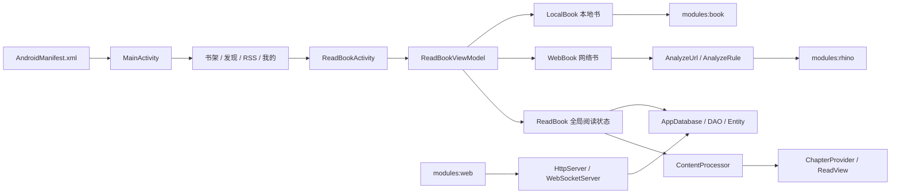
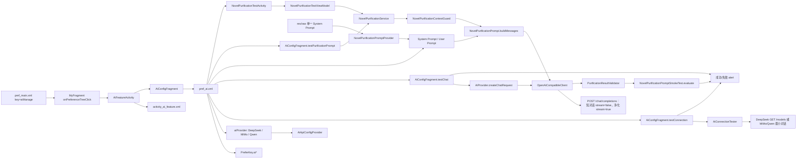
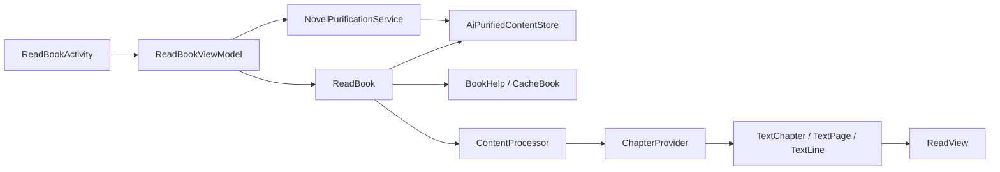

# Legado 代码快速定位图谱

> 最近核对：2026-08-27（包含当前工作区尚未提交的 DeepSeek/MiMo/Qwen AI 功能改动）  
> 核心用途：把用户描述的“前端某个地方”直接映射到资源、事件、状态和业务逻辑，减少全仓库搜索。  
> 范围：Android 主应用优先；同时保留 `modules:web`、`modules:book`、`modules:rhino` 的边界说明。  
> 原则：本文件负责定位，源码负责最终事实。不要依赖容易漂移的行号，优先依赖资源 ID、Preference key、类名和函数名。

## 0. 给 AI 的最短使用规则

收到“修改前端的某个地方”时，按以下顺序定位：

1. 先判断用户说的是 Android App 还是浏览器 Web 界面；未提 Web 时默认 Android App。
2. 把描述拆成“页面 → 区域 → 控件/文字 → 行为”，先查第 2 节口语索引。
3. 只打开该行给出的三类节点：界面定义、事件处理、状态/业务逻辑。
4. 改标题、说明、图标时，再读 `strings.xml` 或 `drawable`；纯逻辑改动不必先扫描全部资源。
5. 只有索引没有命中或源码锚点已失效时，才执行第 0.3 节的局部搜索；不要先全仓库扫描。
6. 实现前仍需读取命中的源码片段，确认当前工作区是否已被用户修改。

推荐的最小阅读量：本节 + 第 2 节对应行 + 一个专项章节。不要为单个 UI 改动通读整份文档。

### 0.1 路径缩写

| 缩写 | 实际路径 |
|---|---|
| `J/` | `app/src/main/java/io/legado/app/` |
| `R/` | `app/src/main/res/` |
| `WEB/` | `modules/web/src/` |

文档中的 `J/ui/ai/AiFeatureActivity.kt` 应展开为 `app/src/main/java/io/legado/app/ui/ai/AiFeatureActivity.kt`。

### 0.2 五类前端入口不能混用

| 用户看到的形态 | 通常定义位置 | 交互处理位置 | 稳定锚点 |
|---|---|---|---|
| 整个页面、固定按钮、输入框 | `R/layout/*.xml` | Activity、Fragment、Dialog | `@+id/...`、Binding 字段 |
| 顶部按钮、右上角三点菜单、勾选项 | `R/menu/*.xml` | `onCompatOptionsItemSelected` 等 | `R.id.menu_*` |
| “我的”里的设置列表、API 设置项 | `R/xml/pref_*.xml` | `PreferenceFragment` | `android:key` |
| 标题、说明、弹窗文案 | `R/values/strings.xml`、`R/values-zh/strings.xml` | `getString(R.string.*)` | `R.string.*` |
| 图标 | `R/drawable/*.xml` 或图片资源 | 布局、菜单、Preference 引用 | `@drawable/*` |

### 0.3 索引失效时的局部搜索

按已知信息选择一种，不要一开始同时运行：

```powershell
# 已知屏幕文字：先找 string 名，再找引用者
rg -n "AI净化|替换净化" app/src/main/res/values* app/src/main/res/menu app/src/main/res/xml

# 已知资源 ID 或 Preference key：限定 UI 与资源目录
rg -n "menu_ai_purify|aiManage" app/src/main/res app/src/main/java/io/legado/app/ui

# 已知类名：直接找文件和调用点
rg -n "class AiFeatureActivity|AiFeatureActivity" app/src/main/AndroidManifest.xml app/src/main/java/io/legado/app
```

若需要从 XML 继续追踪：`layout/menu/pref XML → ID/key → Activity/Fragment → ViewModel/model → helper/data`。

## 1. 项目构成速览



| 模块/层 | 入口 | 作用 |
|---|---|---|
| Android 主应用 | `app/` | Kotlin + XML UI、阅读器、Room、网络、后台服务；当前 AI 功能在这里。 |
| 本地书解析 | `modules/book/` | EPUB、UMD 等格式的底层解析。 |
| 规则脚本 | `modules/rhino/` | 为书源规则执行 JavaScript。 |
| 浏览器 Web 前端 | `modules/web/` | Vue 3/Vite 前端，通过 App 内 HTTP/WebSocket 服务工作。 |
| UI 层 | `J/ui/` | Activity、Fragment、Dialog、Adapter、View。 |
| 协调层 | `J/ui/**/**ViewModel.kt`、`J/model/` | 页面状态、异步任务、业务流程。 |
| 数据层 | `J/data/AppDatabase.kt`、`J/data/dao/`、`J/data/entities/` | Room 和业务实体。 |
| Helper 层 | `J/help/` | 正文处理、配置、HTTP、缓存、WebDAV 等。 |
| Android 资源 | `R/layout/`、`R/menu/`、`R/xml/`、`R/values*/`、`R/drawable/` | 页面结构、菜单、设置列表、文本、图标。 |

## 2. “前端口语”快速定位表

| 用户通常会说 | 界面定义节点 | 事件/页面节点 | 状态或业务节点 |
|---|---|---|---|
| 主界面、底部四个入口 | `R/layout/activity_main.xml`；`R/menu/main_bnv.xml` | `J/ui/main/MainActivity.kt`：`onNavigationItemSelected`、`TabFragmentPageAdapter` | `J/help/config/AppConfig.kt`：发现/RSS 显示和默认首页 |
| 书架页、书架右上角菜单 | `R/layout/fragment_bookshelf1.xml`、`fragment_bookshelf2.xml`；`R/menu/main_bookshelf.xml` | `J/ui/main/bookshelf/BaseBookshelfFragment.kt`；两个 `BookshelfFragment` | `BookshelfViewModel.kt`、Room 的 `BookDao` |
| 发现页 | `R/layout/fragment_explore.xml`；`R/menu/main_explore.xml` | `J/ui/main/explore/ExploreFragment.kt`、`ExploreAdapter.kt` | `ExploreViewModel.kt`、`WebBook.exploreBookAwait` |
| RSS 页 | `R/layout/fragment_rss.xml`；`R/menu/main_rss.xml` | `J/ui/main/rss/RssFragment.kt`、`RssAdapter.kt` | `RssViewModel.kt`、RSS entity/DAO |
| “我的”整个页面 | `R/layout/fragment_my_config.xml` | `J/ui/main/my/MyFragment.kt` | 子 Fragment 从 `R/xml/pref_main.xml` 构建列表 |
| “我的”中的某一行 | `R/xml/pref_main.xml` 的 `android:key` | `MyFragment.MyPreferenceFragment.onPreferenceTreeClick` | key 对应的目标 Activity/配置 |
| “我的 → AI功能”这一行 | `R/xml/pref_main.xml`：key=`aiManage`、icon=`ic_ai` | `MyFragment` 的 `"aiManage"` 分支 | 启动 `J/ui/ai/AiFeatureActivity.kt` |
| AI功能页面、API设置 | `R/layout/activity_ai_feature.xml`；`R/xml/pref_ai.xml` | `AiFeatureActivity.kt`、`AiConfigFragment.kt` | `PreferKey.aiProvider` 与三家独立的 Base URL/API Key/模型 key |
| API服务商切换 | `pref_ai.xml`：key=`aiProvider`；`ai_arrays.xml` | `AiConfigFragment.updateProviderPreferences` | `AiProvider`、`AiApiConfigProvider`；DeepSeek/MiMo/Qwen 配置互不覆盖 |
| API设置里的“测试连接” | `R/xml/pref_ai.xml`：key=`aiTestConnection` | `AiConfigFragment.testConnection` | `AiConnectionTester`：DeepSeek `GET /models`；MiMo/Qwen 最小非思考对话 |
| API设置里的“测试对话” | `R/xml/pref_ai.xml`：key=`aiTestChat` | `AiConfigFragment.testChat` | `AiProvider.createChatRequest` → `OpenAiCompatibleClient` → `POST /chat/completions` |
| AI功能里的 System Prompt | `R/xml/pref_ai.xml`：key=`aiNovelSystemPrompt` | `AiConfigFragment.showSystemPrompt`、`showSystemPromptEditor` | `R/raw/novel_purification_system_prompt.txt` → `NovelPurificationPromptProvider`；只有一个内置文件，SharedPreferences 只保存自定义覆盖 |
| AI功能里的 User Prompt | `R/xml/pref_ai.xml`：key=`aiNovelUserPrompt` | `EditTextPreference`、`AiConfigFragment.updateSummary` | 调用时写入结构化 `purification_input` 的 `ADDITIONAL_INSTRUCTION` 数据段，与 `NOVEL_TEXT` 明确隔离 |
| AI功能里的“测试净化提示词” | `R/xml/pref_ai.xml`：key=`aiTestPurificationPrompt` | `AiConfigFragment.testPurificationPrompt` | `NovelPurificationPrompt.buildMessages` → 当前服务商客户端 → `NovelPurificationPromptSmokeTest.evaluate` |
| 小说文本阅读界面 | `R/layout/activity_book_read.xml` | `J/ui/book/read/ReadBookActivity.kt` | `ReadBookViewModel.kt`、`J/model/ReadBook.kt` |
| 阅读页右上角功能区、三点菜单 | `R/menu/book_read.xml` | `ReadBookActivity.upMenu`、`onCompatOptionsItemSelected` | 每本书的 `Book.ReadConfig` 或当前章节状态 |
| “替换净化”勾选项 | `book_read.xml`：`menu_enable_replace` | `changeReplaceRuleState`、`ReadBookViewModel.replaceRuleChanged` | `Book.get/setUseReplaceRule`、`ContentProcessor.getContent` |
| “AI净化”勾选项 | `book_read.xml`：`menu_ai_purify` | `changeAiPurifyState`、`ReadBookViewModel.aiPurifyChanged/ensureCurrentChapterPurified` | `Book.get/setUseAiPurify`、`AiPurifiedContentStore`、`ReadBook.getAiPurifiedContentOrOriginal` |
| AI净化下方的“重新净化” | `book_read.xml`：`menu_ai_repurify` | `ReadBookActivity.upMenu`、`ReadBookViewModel.repurifyCurrentChapter` | 删除当前章精确缓存键 → 恢复原文 → 新请求；处理中不可重复点击 |
| 阅读页页码后的“原文 / AI净化中 / AI净化” | `PageView` 中实际 `page/pageAndTotal` 的 `BatteryView` | `PageView.upAiPurifyStatus`、`AiPurifyStatusSpan` | 状态以内联 `ReplacementSpan` 紧跟页码文字；Running 时主动刷新旋转圆弧，不占用电量区域 |
| “移除重复标题”勾选项 | `book_read.xml`：`menu_same_title_removed` | `ReadBookActivity.onMenuOpened` 和该 ID 的点击分支 | `ContentProcessor.removeSameTitleCache`、`TextChapter.sameTitleRemoved` |
| 阅读页“添加书签” | `book_read.xml`：`menu_add_bookmark` | `ReadBookActivity.addBookmark` | `Bookmark` entity、`BookmarkDao` |
| 阅读页点中间后出现的底部栏 | `R/layout/view_read_menu.xml` | `J/ui/book/read/ReadMenu.kt` | 目录、朗读、样式、更多设置分别进入对应 Dialog |
| 底部栏的净化快捷按钮 | `view_read_menu.xml`：`fabReplaceRule` | `ReadMenu.upPurifyAction` 和点击分支 | AI 关闭时打开替换规则；AI 开启时改为“重新净化”当前章，处理中禁用 |
| 阅读样式、字体、背景、边距 | `view_read_menu.xml`、`dialog_read_book_style.xml` 等 | `J/ui/book/read/config/ReadStyleDialog.kt` 等 | `J/help/config/ReadBookConfig.kt`、`ChapterProvider.kt` |
| 替换规则管理页面 | “我的”中 key=`replaceManage`；替换规则布局/菜单 | `J/ui/replace/ReplaceRuleActivity.kt` | `ReplaceRuleViewModel`、`ReplaceRuleDao`、`ReplaceRule` |
| 书源管理页面 | “我的”中 key=`bookSourceManage`；书源布局/菜单 | `J/ui/book/source/manage/BookSourceActivity.kt` | `BookSourceViewModel`、`BookSourceDao`、`BookSource` |
| 主题设置、备份设置、其他设置 | `pref_main.xml` 对应 key | `MyFragment` 启动 `J/ui/config/ConfigActivity.kt` | `R/xml/pref_config_theme.xml`、`pref_config_backup.xml`、`pref_config_other.xml` |
| 浏览器里的 Web 书架/源编辑器 | `WEB/views/`、`WEB/components/` | Vue 组件与 Pinia store | `WEB/api/api.ts` → Android `J/web/HttpServer.kt`/controller |

## 3. 从控件类型追踪代码

### 3.1 Menu 菜单项

稳定链路：

```text
R/menu/*.xml 的 android:id
  → Activity/Fragment 中的 R.id.menu_*
  → onCompatOptionsItemSelected 或自定义点击函数
  → ViewModel/model/helper
```

勾选菜单通常还要检查两个位置：

- `upMenu`、`onPrepareOptionsMenu`、`onMenuOpened`：决定打开菜单时的可见、可用、勾选状态。
- 点击分支：改变状态并触发刷新。

阅读页 AI 净化就是标准例子：`menu_ai_purify → upMenu → changeAiPurifyState → Book.ReadConfig → aiPurifyChanged → ReadBook.loadContent`。

其手动重做链路是：`menu_ai_repurify → repurifyCurrentChapter → AiPurifiedContentStore.delete → ReadBook.loadContent（原文）→ NovelPurificationService`。

### 3.2 Preference 设置项

稳定链路：

```text
R/xml/pref_*.xml 的 android:key
  → PreferenceFragment.onPreferenceTreeClick / onSharedPreferenceChanged
  → PreferKey 常量或目标 Activity
  → SharedPreferences / 业务服务
```

注意：`android:key` 是程序标识，不是显示标题。改标题只改 string；重命名 key 必须同步 XML、处理分支、读取/保存点，并考虑旧偏好迁移。

### 3.3 普通 View

稳定链路：

```text
R/layout/*.xml 的 @+id/foo_bar
  → ViewBinding 生成 binding.fooBar
  → Activity/Fragment/Dialog 中的点击或监听
  → ViewModel/model
```

Kotlin 的 ViewBinding 会把下划线转为驼峰，例如 `content_container → binding.contentContainer`。

### 3.4 文字与图标

- 中文显示文本优先查 `R/values-zh/strings.xml`，默认/英文查 `R/values/strings.xml`。
- XML 中看到 `@string/foo` 后，继续搜索 `R.string.foo` 可找到弹窗或动态文本使用点。
- Vector 图标通常是 `R/drawable/*.xml`。替换图标时优先保持已有 VectorDrawable 风格、尺寸和主题着色方式。
- Preference 行的图标直接由 `android:icon="@drawable/..."` 决定，不在 `android:key` 中决定。

## 4. 主界面与“我的”定位图

### 4.1 主界面分页关系

```text
activity_main.xml
  ├─ view_pager_main
  └─ bottom_navigation_view → main_bnv.xml
       ├─ menu_bookshelf → BookshelfFragment1 或 BookshelfFragment2
       ├─ menu_discovery → ExploreFragment
       ├─ menu_rss       → RssFragment
       └─ menu_my_config → MyFragment
```

`MainActivity.TabFragmentPageAdapter` 是底部入口与 Fragment 的权威映射。书架存在两套 Fragment/布局，由 `AppConfig.bookGroupStyle` 选择；改书架 UI 前必须先确定当前样式。

### 4.2 “我的”页面关系


常用 Preference key 映射：

| key | 显示功能 | 点击目标 |
|---|---|---|
| `bookSourceManage` | 书源管理 | `BookSourceActivity` |
| `txtTocRuleManage` | TXT 目录规则 | `TxtTocRuleActivity` |
| `replaceManage` | 替换净化 | `ReplaceRuleActivity` |
| `aiManage` | AI功能 | `AiFeatureActivity` |
| `dictRuleManage` | 字典规则 | `J/ui/dict/rule/DictRuleActivity.kt` |
| `web_dav_setting` | 备份与恢复 | `ConfigActivity` + `ConfigTag.BACKUP_CONFIG` |
| `theme_setting` | 主题设置 | `ConfigActivity` + `ConfigTag.THEME_CONFIG` |
| `setting` | 其他设置 | `ConfigActivity` + `ConfigTag.OTHER_CONFIG` |
| `bookmark` | 所有书签 | `AllBookmarkActivity` |
| `readRecord` | 阅读记录 | `ReadRecordActivity` |

若只是调换“我的”列表顺序，优先改 `pref_main.xml` 中节点顺序；不用改 `MyFragment`。

## 5. 当前 AI 功能定位图

### 5.1 “我的 → AI功能 → API设置”



| 要修改的内容 | 首选文件 | 还要同步检查 |
|---|---|---|
| “AI功能”标题/说明 | `R/values*/strings.xml` 的 `ai_feature*` | `pref_main.xml`、`activity_ai_feature.xml` 的引用 |
| “我的”行图标 | `R/drawable/ic_ai.xml` | `pref_main.xml` 的 `android:icon` |
| “我的”行标识 | `pref_main.xml` 的 `aiManage` | `MyFragment` 的 key 分支；不要只改单边 |
| AI 页面容器 | `activity_ai_feature.xml` | `AiFeatureActivity` 的 `content_container` |
| API 设置项/顺序 | `pref_ai.xml` | `PreferKey.kt`、`AiConfigFragment` |
| 服务商/模型候选项 | `R/values/ai_arrays.xml` | `AiProvider.kt` 默认值、`pref_ai.xml`、上下文模型限制 |
| API Key 掩码/摘要 | `AiConfigFragment.kt` | `aiApiKey`、`aiMimoApiKey`、`aiQwenApiKey` Preferences |
| 测试连接行为 | `AiConfigFragment.testConnection` | `AiConnectionTester.test`、DeepSeek `/models`、MiMo/Qwen 最小对话和错误文案 |
| 测试对话行为 | `AiConfigFragment.testChat` | `AiProvider.kt`、`DeepSeekClient.kt` 中的 `OpenAiCompatibleClient`、通用 DTO/异常 |
| 修改内置 System Prompt 正文 | 直接修改唯一的 `R/raw/novel_purification_system_prompt.txt` | 不创建历史副本；同步固定语料测试，内容 hash 会自动隔离旧缓存 |
| 内置提示词读取与缓存 | `NovelPurificationPromptProvider.kt` | 当前为 `R.raw.novel_purification_system_prompt`、UTF-8、非空校验 |
| 自定义 System Prompt | `AiConfigFragment.showSystemPrompt*` | key=`aiNovelSystemPrompt`、恢复默认逻辑；不覆盖内置 raw 资源 |
| 用户额外净化要求 | `pref_ai.xml` 的 key=`aiNovelUserPrompt` | `NovelPurificationPrompt.buildMessages` 的 `ADDITIONAL_INSTRUCTION` 数据段；冲突时服从 System Prompt 硬约束 |
| 整章上下文预算保护 | `NovelPurificationContextGuard.kt` | DeepSeek 1M/384K、MiMo 1M/128K、Qwen 3.8 1M/131072、UTF-8 保守估算、安全余量、动态输出预算 |
| 生产响应最小校验 | `PurificationResultValidator.kt` | 只检查 finish reason、非空正文和原文 SHA-256；不判断文本质量 |
| 统一小说净化调用 | `NovelPurificationService.kt` | 整章单次请求、上下文预检、消息构造、结果校验；不自动重试 |
| 运行配置与缓存指纹 | `NovelPurificationRuntimeConfig.kt` | 经 `AiApiConfigProvider` 读取当前服务商；签名包含服务商但不包含 API Key |
| 阅读页 AI 独立缓存 | `AiPurifiedContentStore.kt` | `noBackupFilesDir/ai_purification_cache/v2`、原文 SHA-256、配置签名、内容寻址、旧格式自动迁移、原子式写入 |
| 阅读页后台任务 | `ReadBookViewModel.ensureCurrentChapterPurified/repurifyCurrentChapter` | 单请求串行队列；新当前章抢占不同章节的后台请求；后台任务本身成为当前章时接管累计流和阅读位置 |
| 下一章自动预净化 | `ReadBookViewModel.enqueueNextChapterIfNeeded` | 当前章 Ready 后入队；只读已有正文且不触发下载；正文稍后加载完成时重试；后台失败在用户进入该章时自动重试一次 |
| 阅读页 AI 来源状态 | `PageView.upAiPurifyStatus`、`AiPurifyStatusSpan.kt` | `ReplacementSpan` 跟随实际页码文字；旋转圆弧只在当前章 Running/排队时主动逐帧刷新 |
| 底部净化快捷按钮 | `ReadMenu.upPurifyAction`、`view_read_menu.xml` 的 `fabReplaceRule` | AI 关闭时 `openReplaceRule`；AI 开启时 `repurifyCurrentChapter` |
| 固定脏文本及自动判定 | `NovelPurificationPromptSmokeTest.kt` | `AiConfigFragment.testPurificationPrompt`、对应单元测试 |
| 粘贴正文测试页 | `NovelPurificationTestActivity.kt` | `NovelPurificationTestViewModel.kt`、`activity_novel_purification_test.xml`、key=`aiNovelPurificationTest` |

当前实现边界：

- 已有：DeepSeek/MiMo/Qwen 服务商切换、各自独立的 Base URL/API Key/模型、共用思考模式，以及 DeepSeek `low/high/max` 推理强度（小说净化默认 `low`）；安全掩码；DeepSeek 用 `/models`、MiMo/Qwen 用最小对话测试连接并弹窗。
- 已有：通用 OpenAI 兼容 `/chat/completions` 客户端，同时支持完整 JSON 和单请求 SSE 流式响应；包含请求/响应 DTO、`[DONE]` 校验、错误映射、超时和协程取消。`AiProvider` 分派 DeepSeek 的 `thinking/max_tokens/reasoning_effort`、MiMo 的 `thinking/max_completion_tokens` 和 Qwen 的 `enable_thinking/thinking_budget/max_completion_tokens`。
- 已有：AI 功能页“测试对话”，发送固定短消息并显示模型、结束原因、Token 和回复。
- 已有：唯一的内置 System Prompt 位于 `res/raw` 纯文本，采用普通正文段首两个全角空格、段落单换行且不留空行的简化文学排版；由 Provider 首次读取后在进程内缓存，查看后点“编辑”才能整体覆盖，并支持恢复默认。提示词不保留历史资源和版本号，缓存由内容 hash 失效。
- 已有：System Prompt 定义硬约束；可选 User Prompt 与完整正文被封装进单个 `name=purification_input` 结构化消息的独立数据段，原文之后追加短输出命令；API 仍返回纯文本，不使用 JSON 模式。
- 已有：整章上下文预算保护；保守估算超过安全上下文或最大输出限制时不发送 API 请求，不做分块。
- 已有：生产响应最小校验，只检查技术完整性和原文版本；校验失败不自动重试，效果不理想时由读者取消 AI 净化恢复原文。
- 已有：`NovelPurificationService` 统一执行整章单次请求、上下文保护和最小响应校验，文本计算固定在 `Dispatchers.Default`。
- 已有：AI 功能页“测试净化提示词”，先经过上下文保护和最小校验，再用固定语料规则诊断提示词效果。
- 已有：AI 功能页“文本净化测试”，可粘贴正文、取消请求、查看/复制结果和手动重新净化；净化中显示居中转圈遮罩且主线程保持响应。页面不显示模型、Token 等无助于判断正文效果的信息，内容只保存在页面内存中。
- 已有：阅读页 AI 净化勾选、单请求串行队列、独立文件缓存、缓存命中显示、关闭恢复原文，以及跟随实际页码的“原文 / 转圈 AI净化中 / AI净化”三态标识。
- 已有：AI 文件缓存采用内容寻址 v2 主键；目录刷新造成的书籍 URL、章节 URL 或章节序号变化不再令相同原文和配置的结果失效，当前身份仍可定位的旧格式缓存会在读取时迁移。
- 已有：章内翻页不改任务；切到不同章节时，新当前章取消并抢占旧后台请求。若正在预净化的下一章恰好成为当前章，则接管已累计正文而不重发。当前章 Ready 后自动尝试下一章，正文暂不可用时等待已有加载完成事件再入队。
- 已有：AI 净化勾选后显示“重新净化”；它只删除当前章精确缓存，恢复原文并主动请求一次，进行中禁用。
- 已有：当前章请求开始时保留标题并清空正文，同一 SSE 请求的最新累计正文以 400 ms 最小间隔重排；即使尚未换行也能显示当前行。完整结果校验通过前不写入缓存。AI 调用异常或取消时清除预览，恢复原位置和原文。
- 产品边界：正式阅读流程不实现差异高亮、接受修改或确认页面；完成后直接显示独立缓存结果，取消勾选恢复原文。
- 提示词单元测试：`app/src/test/java/io/legado/app/model/ai/purify/NovelPurificationPromptTest.kt`。
- 净化链路单元测试：`NovelPurificationContextGuardTest.kt`、`PurificationResultValidatorTest.kt`、`NovelPurificationServiceTest.kt`。
- API 开发参考：根目录 `DEEPSEEK_API_DEVELOPMENT.md`、`MIMO_API_DEVELOPMENT.md`、`QWEN_API_DEVELOPMENT.md`。
- 产品设计参考：根目录 `AI_NOVEL_PURIFICATION_DESIGN.md`。

## 6. 阅读界面与 AI 净化定位图

### 6.1 阅读器主链



`ContentProcessor.getContent` 是排版前同步、高频处理路径。真正的 AI 网络请求不能直接放进去，否则翻页、预加载、重排会触发不可控请求。正确方向是：ViewModel/model 异步请求 → 缓存净化结果 → `ReadBook.loadContent` 读取结果 → `ContentProcessor` 只做轻量选择/格式化。

### 6.2 右上角功能区的准确映射

| 可见项 | Menu ID | 菜单状态更新 | 点击处理 | 最终状态/处理 |
|---|---|---|---|---|
| 替换净化 | `menu_enable_replace` | `ReadBookActivity.upMenu` | `changeReplaceRuleState` | `Book.useReplaceRule`；`ContentProcessor` 应用 ReplaceRule |
| AI净化 | `menu_ai_purify` | `ReadBookActivity.upMenu` | `changeAiPurifyState` | `Book.useAiPurify`；后台调用、独立缓存、直接显示或恢复原文 |
| 重新净化 | `menu_ai_repurify` | `ReadBookActivity.upMenu`（仅 AI 已勾选时显示） | `ReadBookViewModel.repurifyCurrentChapter` | 删除当前章精确缓存、恢复原文、发起新请求 |
| 移除重复标题 | `menu_same_title_removed` | `onMenuOpened` | 同 ID 的点击分支 | `removeSameTitleCache`、当前 `TextChapter` |
| 重新分段 | `menu_re_segment` | `upMenu` | 同 ID 的点击分支 | `Book.reSegment`、`ContentHelp.reSegment` |
| 添加书签 | `menu_add_bookmark` | 无勾选状态 | `addBookmark` | 构造并保存 Bookmark |

AI 净化当前完整链路：

```text
book_read.xml: menu_ai_purify
  → ReadBookActivity.upMenu
  → ReadBookActivity.changeAiPurifyState
  → Book.setUseAiPurify（同时关闭 useReplaceRule）
  → ReadBook.saveRead
  → ReadBookViewModel.aiPurifyChanged
  → ReadBook.loadContent(resetPageOffset = false)
  → ReadBookViewModel.ensureCurrentChapterPurified
  → NovelPurificationRuntimeConfigProvider
  → NovelPurificationService（后台、可取消）
  → 当前章保留标题、正文置空
  → 同一请求的最新累计正文节流重排
  → AiPurifiedContentStore（最终全文校验后原子写入）
  → ReadBook.loadContent(resetPageOffset = false)
  → ReadBook.getAiPurifiedContentOrOriginal
  → ContentProcessor / ChapterProvider / ReadView 重排显示
```

相关约束：

- `Book.ReadConfig.useAiPurify` 按书保存；`readConfig` 是 Book 现有字段中的 JSON，不是新 Room 列，因此本次新增属性不要求数据库 migration。
- `NovelPurificationRuntimeConfigProvider` 通过 `AiApiConfigProvider` 读取当前 DeepSeek/MiMo/Qwen 配置；服务商 ID 进入缓存签名，API Key 不进入。`AiProvider` 负责 `max_tokens` 与 `max_completion_tokens` 的互斥分派，并隔离各服务商的思考字段。
- AI 净化启用时，`Book.setUseAiPurify` 强制关闭替换净化；`upMenu` 同时让替换净化不可点击。
- `changeReplaceRuleState` 也有保护，覆盖阅读页自定义点击区域动作触发替换净化的情况。
- 当前章请求开始后保留标题、立即清空正文，之后只展示当前单请求的内存累计正文。取消 AI 净化后取消任务、恢复原位置、清除预览并重新加载原始章节，正文缓存始终不被改写。
- `PageView` 将 `AiPurifyStatusSpan` 作为内联 `ReplacementSpan` 追加到实际页码字符串，使状态直接跟在页码后；Running 时由 Span 主动让页码控件逐帧重绘，避免 `BatteryView` 绘制缓存令动画停住。同时按当前页章节映射状态，避免跨章误标。
- `ReadMenu.upPurifyAction` 动态同步 `fabReplaceRule`：AI 关闭时保持替换规则入口，AI 开启时显示 AI 图标和“重新净化”，当前章处理中禁用。
- 同章翻页不改任务；切到新章节时，新当前章抢占不同章节的后台任务。若新当前章就是正在预净化的章节，则直接接管该请求的累计正文和流式状态。
- 当前章 Ready 后只预净化下一章；`BookHelp.getContent` 返回空时不触发章节下载，并在阅读器原有的正文加载完成事件到达后重试。
- 同一缓存键失败后不会自动重复请求；用户可以点击“重新净化”明确重试，或者关闭再开启 AI 净化开始新的启用会话。
- 缓存测试：`AiPurifiedContentStoreTest.kt`，覆盖书籍/章节 URL 或序号变化后继续命中及旧格式迁移；配置签名测试：`NovelPurificationRuntimeConfigTest.kt`。

### 6.3 阅读页底部菜单不是 `book_read.xml`

用户说“点阅读区中间出现的目录/朗读/界面/设置”时，应定位：

```text
R/layout/view_read_menu.xml
  → J/ui/book/read/ReadMenu.kt
  → J/ui/book/read/config/*Dialog.kt
  → ReadBookConfig / AppConfig
```

不要把它与右上角三点菜单 `R/menu/book_read.xml` 混淆。

## 7. 常见业务定位补充

| 任务 | 最小源码集合 |
|---|---|
| 改正文清洗、替换、分段、简繁 | `J/help/book/ContentProcessor.kt`、`ContentHelp.kt`、`J/data/entities/ReplaceRule.kt` |
| 改阅读排版、字体、边距、翻页 | `J/help/config/ReadBookConfig.kt`、`J/ui/book/read/page/provider/ChapterProvider.kt`、`J/ui/book/read/page/ReadView.kt` |
| 改网络正文获取 | `J/model/webBook/WebBook.kt`、`BookContent.kt`、`J/model/analyzeRule/AnalyzeUrl.kt`、`AnalyzeRule.kt` |
| 改本地 TXT/EPUB 等 | `J/model/localBook/LocalBook.kt` 及对应 `TextFile/EpubFile/...`；底层看 `modules/book/` |
| 改书源规则语法 | `AnalyzeUrl.kt`、`AnalyzeRule.kt`、`modules/rhino/`；必须保持旧书源兼容 |
| 改 Room 实体 | `J/data/entities/`、对应 DAO、`AppDatabase.kt`、`DatabaseMigrations.kt`、`app/schemas/` |
| 改 Web API | `J/web/HttpServer.kt`、`J/api/controller/`、`WEB/api/api.ts` |
| 改全局设置 | `J/constant/PreferKey.kt`、`J/help/config/AppConfig.kt`、对应 `R/xml/pref_*.xml` |

关键风险：

1. `ReadBook` 是跨页面/服务共享的阅读状态中心，不按普通短生命周期对象处理。
2. `ContentProcessor`、`ChapterProvider` 是高频路径，避免网络、阻塞和重复重计算。
3. Room 实体列变更需要 version、migration 和 schema；实体内既有 JSON 字段新增可选属性要另行判断。
4. 书源规则改动会影响大量用户自定义规则，兼容性优先。
5. 本地文件可能是 SAF `content://`，不能只使用 `File(path)`。
6. `J/help/http/HttpHelper.kt` 的全局网络客户端为了书源兼容含宽松 TLS 行为；AI API 应继续使用独立的安全 OkHttpClient。

## 8. 定位与修改后的最小验证

只改 Markdown/XML 文案时校验引用即可；涉及 Kotlin 时至少编译对应变体。当前常用命令：

```powershell
./gradlew.bat :app:compileAppDebugKotlin --no-daemon
./gradlew.bat :app:testAppDebugUnitTest --no-daemon
./gradlew.bat :app:testAppDebugUnitTest --tests io.legado.app.help.book.AiPurifyPlaceholderTest --no-daemon
```

修改菜单或 Preference 时，额外核对：

- XML 中的 ID/key 是否在处理类中命中。
- 初始状态与刷新状态是否都更新。
- 中文和默认字符串是否同时存在。
- 新 Activity 是否在 `AndroidManifest.xml` 注册。
- 图标资源是否存在，主题着色是否符合现有图标。

## 9. 本图谱的维护规则

以后每增加或改名一个前端功能，更新一条完整定位边，而不是只增加文件名：

```text
用户可见名称
  → 页面/菜单/Preference 资源
  → view ID / menu ID / preference key
  → Activity/Fragment 处理函数
  → ViewModel/model
  → 状态保存位置
  → 内容处理或网络调用
  → 对应测试
```

维护要求：

- 使用项目相对路径和稳定符号，不记录易漂移行号。
- 明确标注“当前已实现”和“规划未实现”，防止把设计文档当代码事实。
- 若类或资源改名，同步更新第 2 节口语索引和对应专项章节。
- 新增 Android 顶层页面时，记录 Manifest；新增 Preference 时，记录 key；新增勾选菜单时，记录状态恢复函数。
- 文档与源码不一致时以源码为准，并在完成当前任务后修正文档。

给后续 AI 的推荐开场指令：

```text
先读 AI_KNOWLEDGE_GRAPH.md 的第 0 节和第 2 节，只打开与我描述的前端位置对应的专项章节和源码。优先按“资源 → ID/key → 处理函数 → 状态/业务”的定位链工作；索引未命中时才做局部 rg，不要先扫描全仓库。
```
